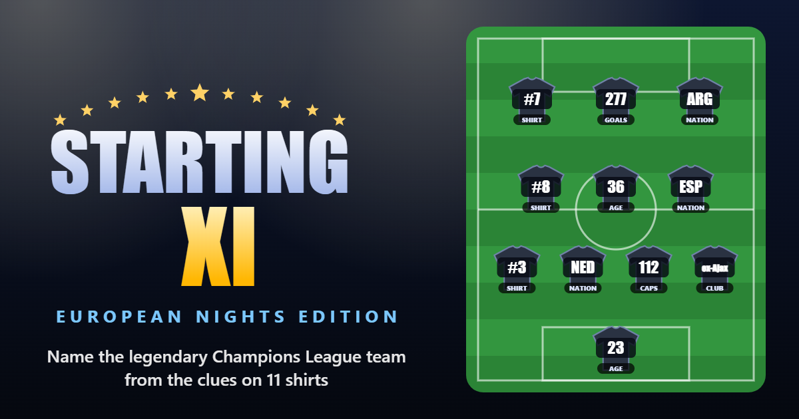

# ⚽ Starting XI – European Nights Edition

**Can you name the legendary Champions League team from 11 shirts of clues?**

### ▶️ [Play now](https://itaya7.github.io/StartingXI/)

Free, no sign-up, no ads. Works on phone and desktop, even offline.

## How to play
1. A famous European Cup / Champions League line-up appears on the pitch, with every name hidden.
2. Each shirt shows a clue: a **flag**, the player's **age**, **shirt number**, **career goals**, **assists**, **international caps** or **previous club**. Tap a shirt to read it in full.
3. **Guess the club.** You get three tries.
4. **Guess the season.** The closer you get, the more points you score.
5. Stuck? Hints can reveal every flag, every shirt number, a player's name, the manager, the decade or the result, but each one costs points.

A perfect round (right club *and* right season) gets the crowd cheering. 🎉

## Game modes
- **Classic:** endless teams. Build a streak and discover every line-up.
- **Time Attack:** 60 seconds on the clock. How many clubs can you name?

## Features
- **80 iconic teams, 1960–2026:** champions, heartbroken runners-up and unforgettable semi-finalists, from Di Stéfano's Real Madrid to Ajax's class of 2019.
- **Three difficulty levels:** more clues and kit colours on Easy, fewer on Hard, where points are multiplied ×1.5.
- **Team ratings:** famous sides score less and deep cuts score more.
- **Filters:** play by decade, winners only, runners-up only, or famous clubs only.
- **Statistics and collection:** track your streaks and points and every team you've discovered.
- **Share your results:** share a result card of your Time Attack run or your overall stats to WhatsApp, X or Facebook.
- **Install it:** add it to your home screen and play like an app, even without internet.
- **Private by design:** no accounts, cookies, trackers or ads. Your progress stays on your own device.

## About the data
Line-ups come from Wikipedia match pages and published match reports. Ages, caps and goals come from each player's Wikipedia page, and players still playing were updated in October 2026. Career assists and a few older figures are estimates, because they were never officially recorded.

Spotted a mistake? [Open an issue](../../issues) and it'll be fixed.

## Disclaimer
Starting XI is a fan-made trivia game and is not affiliated with, endorsed by or connected to UEFA or any football club. Club and player names are used for factual reference only. The game uses generic shirts and its own drawings, with no crests, logos or official artwork.

## License
[MIT](LICENSE) © 2026 itayA7
